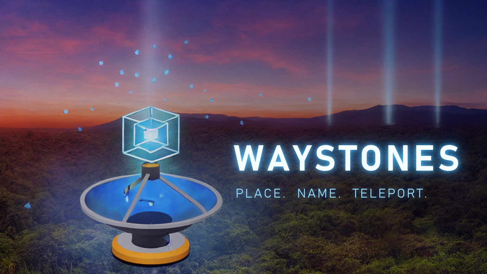
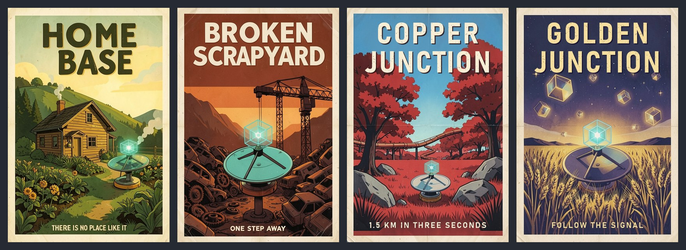

# SMWaystones

Craftable teleport waystones for **Scrap Mechanic Survival**, built on
[SMLoader](https://github.com/CazymirTM/SMLoader). Put one down, put another
one somewhere else, and travel between them.

> Requires **SMLoader 1.1.0+** · Scrap Mechanic **1.0.7a** (Steam, Windows x64) ·
> Survival only · **every player in the world needs it**

## How it works

- **Craft** the Waystone in any Craftbot. It's unlocked from the start and
  costs 10 Metal Block 1 + 1 Circuit Board.
- **Place** it on the ground or on a build: a satellite dish with a floating
  hologram.
- **Press E** to name it, see its coordinates, and pick a destination by name,
  coordinates and distance.
- **Travel:** the dish charges up, the screen fades to black, and you arrive
  next to the other waystone. It works over long distances, even to places that
  aren't loaded.
- **Saved in the world**, names included.

## Where to next?

*Name your waystones and make your own destinations.*

## Install

1. Install [SMLoader](https://github.com/CazymirTM/SMLoader/releases) 1.1.0 or
   newer.
2. Download the SMWaystones zip from **Releases**.
3. Copy its `SMLoader` folder into your game folder and let it merge.
4. Load a Survival world and craft a Waystone.

**Uninstall:** delete `SMLoader\mods\SMWaystones.dll` and the
`SMLoader\SMWaystones` folder. Waystones in your worlds become checkered
"missing part" cubes and come back, with their names, if you reinstall.

## Good to know

- **Steam achievements don't unlock while the mod is installed.** The game
  turns them off when its data files are changed, and a new part changes them.
- **Co-op hasn't been tested yet.** Reports are welcome.
- The mod doesn't change any game files: the merged data is kept in
  `SMLoader\SMWaystones\content\` and rebuilt on every start.
- After a game update the mod may switch itself off until it's updated (see
  `SMLoader\loader.log`).
- Back up your world before trying any mod.

## Bugs and suggestions

Open an [issue](https://github.com/CazymirTM/SMWaystones/issues). Please include
your `SMLoader\loader.log`.

## License

SMWaystones is **closed-source freeware**: free to use, but no re-uploads,
modified versions or reverse engineering. See [LICENSE](LICENSE). Please share
the link to this page instead of the zip.

Made with the help of AI (Claude Code for the code, ComfyUI for the banner,
posters and icon).

*Not affiliated with or endorsed by Axolot Games.*
